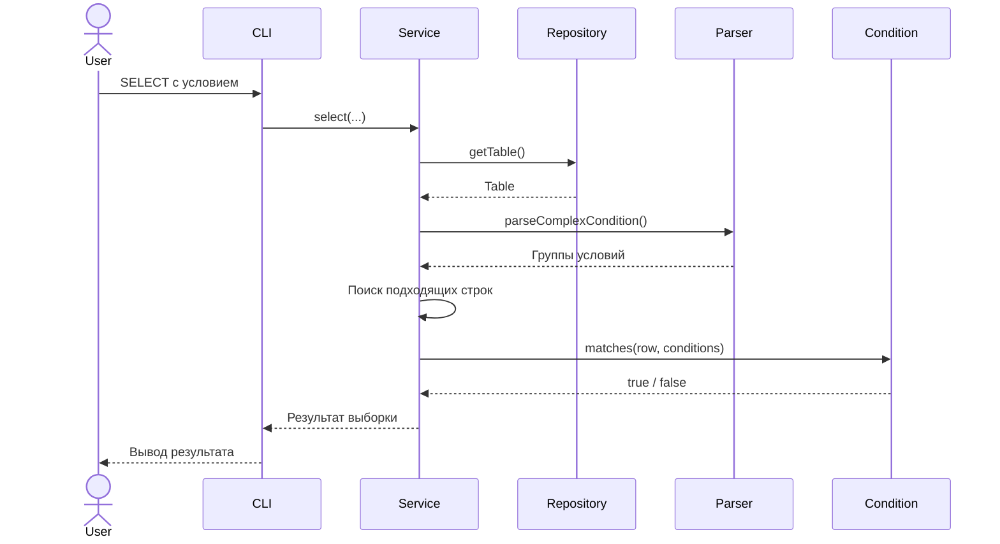

# Cистема управления базами данных

## Описание проекта

СУБД разработана на языке Java 21. 

Данные таблиц сохраняются в JSON-файлах. Для работы с ними реализованы основные операции управления таблицами и записями, проверка ограничений, обработка условий выборки и поддержка индексов.

СУБД также поддерживает обработку сложных условий, типа `AND` и `OR`.

### Основные возможности

- создание и удаление таблиц;
- добавление, изменение и удаление записей;
- выборка данных с условиями;
- поддержка составных условий `AND` и `OR`;
- проверка первичных и внешних ключей;
- поддержка ограничений `PRIMARY KEY` и `NOT NULL`;
- создание индексов для столбцов;
- сохранение данных в JSON-файлах;
- обработка ошибок типов данных и синтаксиса запросов.

## Поддерживаемые запросы

Система поддерживает основные операции, характерные для реляционных баз данных.

| Операция | Назначение |
|---|---|
| `CREATE TABLE` | Создание таблицы |
| `DROP TABLE` | Удаление таблицы |
| `INSERT` | Добавление записи |
| `SELECT` | Выборка записей |
| `UPDATE` | Изменение записей |
| `DELETE` | Удаление записей |
| `CREATE INDEX` | Создание индекса |

### Поддерживаемые типы данных

Для столбцов таблиц предусмотрены следующие типы:

- `INT` — целые числа;
- `DOUBLE` — числа с плавающей точкой;
- `STRING` — строки;
- `BOOLEAN` — логические значения.

Также реализована поддержка ограничений:

- `PRIMARY KEY` — первичный ключ;
- `NOT NULL` — запрет на пустые значения;
- `REFERENCES` — ссылка на столбец другой таблицы.

### Условия выборки

Для построения условий используются операторы сравнения:

| Оператор | Значение |
|---|---|
| `=` | Равно |
| `>` | Больше |
| `<` | Меньше |
| `>=` | Больше или равно |
| `<=` | Меньше или равно |

Строковые значения сравниваются отдельно от остальных типов.

## Структура проекта

Проект организован по пакетам, каждый из которых отвечает за отдельную область функциональности.

```text
JavaLab2/
│
├── .mvn/                   
├── data/                   
│   ├── goods.json
│   └── shops.json
│
├── src/
│   ├── cli/                
│   │
│   ├── config/             
│   │   ├── Condition.java
│   │   └── Operator.java
│   │
│   ├── exception/          
│   │   ├── ConstraintException.java
│   │   ├── SqlSyntaxException.java
│   │   ├── TableException.java
│   │   └── TypeException.java
│   │
│   ├── model/              
│   │   ├── Column.java
│   │   ├── ColumnType.java
│   │   ├── ForeignKey.java
│   │   ├── Index.java
│   │   └── Table.java
│   │
│   ├── repository/         
│   │   ├── Repository.java
│   │   └── TableRepository.java
│   │
│   ├── service/            
│   │   ├── Parser.java
│   │   └── Service.java
│   │
│   ├── test/               
│   │
│   └── Main.java           
│
├── target/                 
├── .gitignore
├── pom.xml                 
├── mvnw                    
└── mvnw.cmd                
```

### Назначение основных компонентов

| Компонент | Назначение |
|---|---|
| `Main` | Запуск приложения |
| `cli` | Взаимодействие с пользователем |
| `Parser` | Разбор условий и частей запросов |
| `Service` | Выполнение операций над таблицами |
| `Repository` | Чтение и запись JSON-файлов |
| `Table` | Представление таблицы |
| `Column` | Описание столбца |
| `Index` | Хранение индексных данных |
| `Condition` | Проверка отдельного условия |
| `ColumnType` | Типы данных и проверка значений |

## Архитектура системы

В проекте используется многослойная архитектура:

1. **CLI** — принимает пользовательские команды и передаёт их на обработку.
2. **Service** — выполняет основные операции с таблицами, проверяет ограничения и управляет индексами.
3. **Parser** — разбирает условия запросов и преобразует их в структуру, пригодную для проверки.
4. **Model** — содержит модели таблиц, столбцов, индексов и внешних ключей.
5. **Repository** — отвечает за чтение и сохранение данных.

### Диаграмма классов

```mermaid
    Main --> CLI
    CLI --> Service
    Service --> Parser
    Service --> Repository
    Service --> Table
    Service --> Condition
    TableRepository --|> Repository
    Table *-- Column
    Table *-- Index
    Column --> ColumnType
    Column --> ForeignKey
    Condition --> Operator
```

### Диаграмма последовательности выполнения SELECT

Ниже показан общий процесс выполнения запроса выборки с условиями.



При наличии подходящего индекса система может использовать его для предварительного поиска строк. После этого оставшиеся условия проверяются обычным способом.

## Индексация данных

Для ускорения поиска записей в проекте реализована поддержка индексов.

Индекс представляет собой структуру, которая связывает значение определённого столбца со списком позиций строк, содержащих это значение.

В качестве внутреннего хранилища используется `Map<String, List<Integer>>`.

### Создание индекса

Для создания индекса используется операция `CREATE INDEX`.

При создании индекса:

1. Загружается таблица.
2. Проверяется существование указанного столбца.
3. Проверяется уникальность имени индекса.
4. Создаётся объект `Index`.
5. Для каждой строки определяется значение индексируемого столбца.
6. В индекс добавляется соответствие между значением и позицией строки.
7. Обновлённая таблица сохраняется в JSON-файл.

### Использование индекса

При выполнении `SELECT` система проверяет, можно ли использовать существующий индекс.

В текущей реализации индексы применяются для условий равенства:

- `=`;
- строкового равенства.

Если подходящий индекс найден, система получает список позиций строк по искомому значению и использует их для дальнейшей проверки условий.

### Обновление индексов

После изменения данных индексы должны соответствовать актуальному состоянию таблицы.

Поэтому после операций:

- `INSERT`;
- `UPDATE`;
- `DELETE`;

выполняется перестроение существующих индексов.

Метод `rebuildIndexes()` очищает индексные структуры и заново формирует соответствия между значениями столбцов и позициями строк.

## Тестирование производительности индексации

Для проверки эффективности индексации был написан код, выполняющий select-метод в service, сравнивались два сценария:

1. Последовательный перебор всех строк таблицы.
2. Поиск через хеш-индекс.

### 6.1. Условия

Для тестирования использовалась таблица со следующими параметрами:

| Параметр | Значение |
|---|---:|
| Количество записей | 1 000 000 |
| Индексируемый столбец | `id` |
| Количество измеряемых итераций | 1 000 |

В ходе тестирования:

- создавалась таблица;
- добавлялось 1 000 000 записей;
- создавался индекс по столбцу `id`;
- таблица загружалась в память;
- выполнялся последовательный поиск;
- выполнялся поиск через индекс;
- результаты измерений сравнивались.

Для уменьшения влияния порядка выполнения операций способы поиска чередовались: в одних итерациях сначала выполнялся последовательный поиск, в других — индексный.

**Важно:** эксперимент сравнивает именно поиск в уже загруженных в память данных. Время чтения JSON-файла, разбора SQL-запроса и форматирования результата в измерение не входит.

### 6.2. Результаты

По результатам запуска теста индексный поиск оказался почти в 1000 раз быстрее последовательного поиска.

Точные значения времени необходимо перенести из вывода программы:

| Способ поиска | Среднее время |
|---|--------------:|
| Без индекса |    `13,96` мс |
| С индексом |    `0,017` мс |
| Ускорение | 821 раз |


## 7. Сборка проекта

Для сборки проекта используется **Apache Maven**.

В проект добавлен Maven Wrapper, поэтому устанавливать Maven отдельно для запуска не нужно.

### Требования

- JDK версии 21;

Проверить установленную версию Java можно командой:

```bash
java -version
```

### Сборка

В командной строке или Git Bash из корневой папки проекта:

```bash
./mvnw.cmd clean package
```

## 8. Запуск проекта

### Через IntelliJ IDEA

1. Открыть проект в IntelliJ IDEA.
2. Убедиться, что в качестве SDK выбран JDK 21.
3. Дождаться загрузки зависимостей Maven.
4. Открыть класс `Main`.
5. Запустить метод `main()`.

### Через Maven

В `pom.xml` настроен `exec-maven-plugin`, и приложение можно запустить командой:

```bash
./mvnw exec:java
```

При первом запуске приложение создаёт начальные таблицы `shops` и `goods`, а также каталог `data`, в котором они хранятся, если они ещё отсутствуют.

## 9. Инструкция пользователя

### 9.1. Структура таблиц

**Таблица `shops` — магазины:**

| Столбец | Тип | Ограничение |
|---|---|---|
| `id` | INT | PRIMARY KEY |
| `address` | STRING | — |
| `city` | STRING | — |
| `isOpen24h` | BOOLEAN | — |

**Таблица `goods` — товары:**

| Столбец | Тип | Ограничение |
|---|---|---|
| `id` | INT | PRIMARY KEY |
| `name` | STRING | — |
| `category` | STRING | — |
| `price` | DOUBLE | — |
| `shopId` | INT | REFERENCES shops(id) |

### 9.2. Добавление магазина

```sql
INSERT INTO shops (id, address, city, isOpen24h)
VALUES (1, 'Lenina 10', 'Moscow', true);
```

### 9.3. Добавление товара

```sql
INSERT INTO goods (id, name, category, price, shopId)
VALUES (1, 'Laptop', 'Electronics', 1200.0, 1);
```

Поле `shopId` указывает на магазин, в котором находится товар.

### 9.4. Выборка всех магазинов и товаров

```sql
SELECT * FROM shops;
```

```sql
SELECT * FROM goods;
```

### 9.5. Выборка с простым условием

Например, получение товаров дороже 100 денежных единиц:

```sql
SELECT * FROM goods
WHERE price > 100;
```

### 9.6. Выборка со сложным условием

Система поддерживает объединение условий с помощью операторов `AND` и `OR`.

Например:

```sql
SELECT * FROM goods
WHERE price > 100 AND category = 'Electronics'
OR price < 50 AND category = 'Accessories';
```

В результате будут выбраны товары, удовлетворяющие хотя бы одной из двух групп условий:

1. Цена больше 100 и категория — `Electronics`.
2. Цена меньше 50 и категория — `Accessories`.

Таким образом, внутри одной группы условия объединяются оператором `AND`, а группы между собой — оператором `OR`.

### 9.7. Изменение данных

Например, изменение цены товара с идентификатором 1:

```sql
UPDATE goods
SET price = 999.0
WHERE id = 1;
```

### 9.8. Удаление данных

Удаление товара с идентификатором 1:

```sql
DELETE FROM goods
WHERE id = 1;
```

### 9.9. Создание индекса

Например, создание индекса по столбцу `price` таблицы `goods`:

```sql
CREATE INDEX idx_goods_price
ON goods(price);
```

Индекс позволяет ускорить выборку товаров по точному совпадению значения индексируемого столбца.

### 9.10. Удаление таблицы

Например, удаление таблицы товаров:

```sql
DROP TABLE goods;
```

Таблицу `shops` нельзя удалить, пока на неё ссылается внешний ключ `goods.shopId`.
## 10. Обработка ошибок и ограничений

Для обработки ошибок в проекте предусмотрены собственные классы исключений.

| Исключение | Назначение |
|---|---|
| `ConstraintException` | Нарушение ограничений данных и связей |
| `SqlSyntaxException` | Ошибка синтаксиса запроса |
| `TableException` | Ошибка при работе с таблицами |
| `TypeException` | Несовместимость типов данных |

Использование отдельных исключений позволяет разделять ошибки по категориям и упрощает их обработку.

## 11. Распределение обязанностей участников


| Участник                             | Область ответственности                                   |
|--------------------------------------|-----------------------------------------------------------|
| `Ковалевич Даниил Дмитриевич 25КНТ5` | `Класс-сервис, парсер, обработка условий, сборка проекта` |
| `Андреев Илья Витальевич 25КНТ6`     | `Класс-репозиторий, модели хранения данных`               |
| `Дятлов Арсений Дмитриевич 25КНТ6`   | `Консольный интерфейс, модели хранения данных`            |

## 12. Выводы

Данная СУБД умеет выполнять основные SQL команды, обрабатывать условия, включая сложные. 
Также был реализован алгоритм индексации, ускоряющий select-запрос на больших таблицах в 800 раз